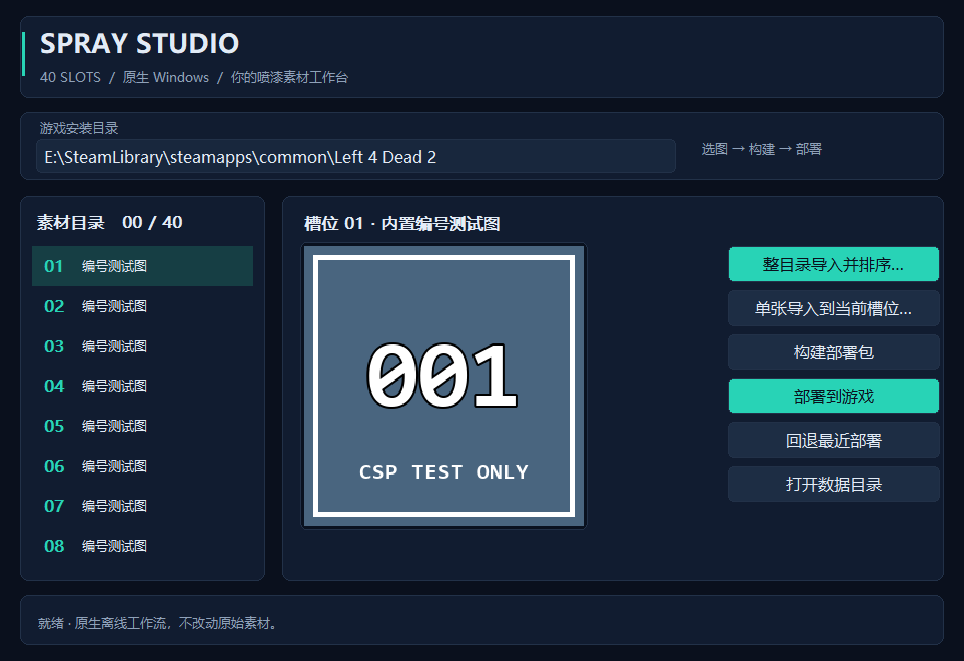

# L4D2 ESC Enhanced — C 与喷漆工具

求生之路 2 的全屏 ESC 菜单整合包，另提供独立 40 槽喷漆选择器及 Go + Win32 导入工具。**当前汇总发布为 v1.5.0（预发布）：C 仍为 1.3.2／DLL 1.3.1，Spray Studio 工具为 1.2.0，新增深色卡片界面和内置图标。**

## 📌 下载与使用说明

**[v1.5.0 Release：下载当前全部产物](https://github.com/STC214/L4D2-ESC-Enhanced/releases/tag/v1.5.0)**，安装步骤和附件区别见 [发布说明](docs/releases/v1.5.0.md)。

- 全部功能：下载 `L4D2_ESC_All_Products_v1.5.0.zip`，其中 game 是游戏文件、manager 是独立工具；不包含 L4N 平台。
- 只装 C：先读 [C 使用说明](docs/C使用说明.md)，下载 `C_session_release.zip`，本体内容与 C 1.3.2 一致。
- 喷漆：先装 `CSP_Selector_Complete_v1.5.0.zip`（包括必需的 update 素材），再使用 `CSP_Spray_Manager_v1.2.0.zip` 或单独 EXE。详见 [喷漆工具说明](docs/喷漆导入工具.md)。

### C 安装简表

1. 完全退出游戏，备份已有 C 的 VPK 和 `CSessionDefaults.dll`。
2. 保留并确认已有 **L4N 加载器**正常工作；发布 ZIP 不包含完整 L4N 平台。
3. 将 ZIP 内容解压到**含 `left4dead2.exe` 的游戏根目录**，同时更新下面两个文件：

   ```text
   left4dead2/addons/【00】C_ESC_LED_血条和速度_TUMTaRA.vpk
   bin/neko/plugins/CSessionDefaults.dll
   ```

4. 停用旧 C、原版 A/B、独立来源 HUD/手电/主菜单按钮包，避免同路径覆盖；不要同时加载旧手电测试 VPK。
5. 重启游戏，进入地图后按 ESC 使用菜单。

**不要只安装 VPK。** 单独的 `C_ESC_LED_Health_Speed_TUMTaRA.vpk` 只是资源包，不包含 DLL；自动默认项和 10 个勾选框的提交都需要配套 DLL 1.3.1。完整安装、校验、更新和回退见教程。

## 当前功能与行为

| 功能 | 当前行为 |
|---|---|
| 全屏 ESC | 整屏约 91% 不透明黑色背景；左列原生菜单置顶，自定义菜单置于“退出到主菜单”下方；二值设置前置，其余数值项目保持原相对顺序 |
| 10 个勾选框 | 勾选/取消即提交，无额外“应用”按钮；材质参数可能在后续渲染帧生效，组件会延迟确认 |
| 自动默认项 | 每次进入可游玩地图初始化一次；手动修改后反复 ESC 不重置，下一关/同图重载/重新连接再初始化 |
| 血条与速度 | 集成本人/队友血条、速度数字和仪表盘；显示速度，不修改角色移动速度；未引入 HUD 来源包的准星 |
| 聊天布局 | 聊天区域位于速度图形表与右侧武器 HUD 之间，输入框底边对齐本玩家血条底边 |
| TUMTaRA | 合并主菜单入口与启动菜单，**不包含地图本体**；需另装地图依赖 |
| 手电 | 集成普通格式贴图与末端淡出抑制/RGB 增益；不等于消除所有距离、角度、阴影衰减，也不保证观感恰好翻倍 |

### 进图默认项

| 设置 | 值 |
|---|---:|
| 雨量、雪量、雾覆盖、雾气开启、客户端尸体数量 | 0 |
| `sv_disable_glow_survivors`、`sv_disable_glow_faritems` | 0 |
| 光亮度 `r_flashlightconstant` | 1 |
| 光射程 `r_flashlightfar` | 3000 |
| 手电光圈 `r_flashlightfov` | 114（菜单范围 50～200） |

两个轮廓参数是“**禁用轮廓**”：默认 0，即“关闭角色轮廓 / 关闭远处物品轮廓”**不勾选**。服务器可能覆盖这些值；0 不保证任意实体都能隔墙显示。默认项不是持续锁定。

## 依赖与限制

- Windows x86 / 已核对的游戏二进制版本及现有 L4N。未知引擎或 GameUI 版本会停用相应组件并记日志，不自动适配。
- TUMTaRA 地图依赖与可选地图见 [安装说明](docs/C使用说明.md)；有菜单不代表已装地图。
- 发布包按 **1280×720** 构建，网络图高度为 620。ESC 布局有比例锚点，但网络图像素高度**不是运行时分辨率自适应**。
- **C 不提供小地图或世界导航。** `nav_edit`“导航网格编辑”只是网格调试开关，不是小地图或自动寻路。Evolved / Skeeto 的研究资料与 C 分开，其平台自动安装器尚未实现；现有喷漆 EXE 不是该平台安装器。
- 游戏日志、部分用户实测及自动化测试各有覆盖边界；预发布不代表所有服务器、字体、HUD 组合都已验收。

## 文档与开发

- [文档索引：当前说明、平台资料、版本记录与历史归档](docs/INDEX.md)
- [勾选提交机制、延迟确认及日志](docs/C勾选与提交.md)
- [开发、构建、验证和部署](docs/开发与验证.md)
- [Go + Win32 喷漆工具：整目录导入、自然排序、40 槽位、备份与回退](docs/喷漆导入工具.md)
- [v1.5.0 新界面、附件与验证边界](docs/releases/v1.5.0.md)
- [v1.3.1 变更与验证边界](docs/releases/v1.3.1.md)

历史 B 版安装、旧默认光圈 179/53/150、右下聊天框、旧成员计数和测试包记录已移入 `docs/archive/`，不再混作当前使用步骤。业务文档统一放在 `docs/`；根目录 `AGENTS.md` 是生效的工作区规则，不属于用户教程。

## 独立喷漆工具

原生 Windows x64 EXE，无 Python 运行依赖；游戏内桥接 DLL 仍为 x86。支持单张指定槽位，以及包含子目录的整目录导入，合并后按自然文件名排序（1、2、10），超出 40 张或遇坏图整批停止。重复来源固定更新原编号最小的槽位；保留备份与未完成事务恢复入口。

游戏中要在**进入战役前**选择喷漆，局内更换不会立即刷新。Go 工具 33 项测试连续两轮通过，原生自绘窗口及 7 尺寸图标检查通过；人工目录对话框与真实图片观感仍需试用，不把自动测试等同于全部实机验收。

下图是离屏主题渲染预览，不是桌面截图：


