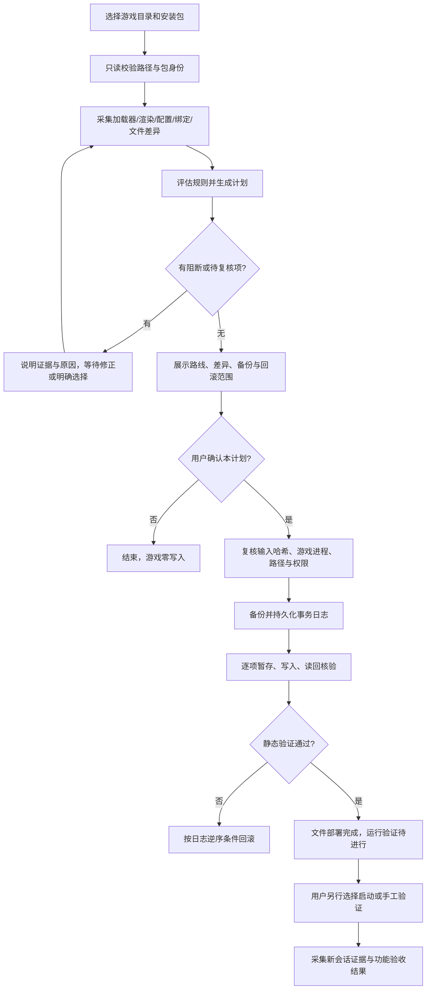

# L4D2Evolved 自动适配：检查流程、决策路径与 EXE 实现规范

版本：设计规范 v1。适用基线：已研究的 Evolved 1.2.5 与现有 L4N 环境。

**当前交付是设计文档及规则数据，不是安装器或已验证的自动配置引擎。** 后续 EXE 应实现本文的状态与验收条件，不应把现有审查脚本直接打包后就称为自动安装器。

配套规则：[evolved-adaptation-rules.v1.json](evolved-adaptation-rules.v1.json)。本机依据：[适配检查](../research/workshop_3785109042/本机游戏适配方案.md)、[原始检查报告](../research/workshop_3785109042/local_game_assessment.json)。

## 1. 目标、范围和不变量

目标是把“人工读目录后作判断”转成：**采集事实 → 形成证据 → 判定路线 → 展示修改计划 → 经确认执行 → 可验证、可恢复**。

- 默认只检查；检查和生成计划阶段对游戏目录零写入。
- 游戏路径由用户选择或确认，不能固定为本机 E 盘；当前路径只作为回归样例。
- 保留游戏 EXE、现有 L4N、渲染组件、C、玩家绑定与模组启用状态。
- 不自动运行包内 EXE、BAT、PS1，不加载第三方 DLL 来“试探版本”。
- 文件存在、导出函数匹配、旧日志和运行成功是四种不同证据。
- 同一输入应给出相同的计划；重复执行不重复安装、不夺取原有文件的卸载所有权。
- 新版本、新格式、新加载器只能进入待复核分支，不套用 1.2.5 的固定规则。

## 2. 总流程与状态机



正常状态链：

```text
CREATED → INSPECTED → PLANNED → AWAITING_CONFIRMATION
→ BACKED_UP → APPLYING → FILES_VERIFIED → RUNTIME_PENDING
→ RUNTIME_VERIFIED（仅在完整运行验收通过时）
```

补充分支：

- 证据不完整或选择未确定：`NEEDS_REVIEW`，仅生成报告，不写游戏。
- 写入失败：`FAILED → ROLLING_BACK → ROLLED_BACK`。
- 回滚遇到后续修改：`ROLLBACK_CONFLICT`，保留当前文件与备份，列明冲突。
- 部署后运行测试失败：保留部署状态和测试失败记录；另行确认回滚，不自动删除运行期间产生的数据。
- 单个可选项延期必须写入新计划；不允许静默跳过后仍称“全部完成”。

## 3. 输入和证据模型

### 输入

| 输入 | 用途 |
|---|---|
| `game_root` | 经确认的目标游戏根目录 |
| `package_path` | 本地原包或下载后的缓存文件 |
| `profile_id` / `profile_revision` | 明确版本的适配规则 |
| `mode` | inspect / plan / apply / verify / rollback |
| 用户偏好 | 保留准星、所选小地图、快捷键、是否允许更换已有 Evolved 等 |
| `transaction_id` | 追踪一次部署与恢复，不使用“最近一个目录”隐式选目标 |

工坊地址用于定位来源，不等于安装包真实性或兼容性证明。下载 SHA-256 与可信、已审阅的版本配置比对；不能仅信任同一下载包自带的哈希。

### 每项事实都保存以下字段

```text
fact_id, value, status, evidence_path, evidence_sha256,
observed_at_utc, source_kind, limitations
```

`status` 为 known / unknown / not_applicable。`source_kind` 区分 file、parsed_config、PE、historical_log、current_session、user_confirmation。

例如旧日志记载 DXVK 3.1.1，只产生“曾使用 DXVK”的事实；当前 DLL 的版本或当前运行状态仍需各自的证据。缺失字段、读取失败和未知值不能默认为 false。

报告不复制 Steam 账户资料、无关个人文件和完整地图包；默认只收集目标范围内的必要片段与哈希。

## 4. 检查阶段：必须按此顺序执行

### S01：验证目标目录

1. 解析规范化绝对路径，确认存在 `left4dead2.exe` 和 `left4dead2/`；验证 EXE 的 PE 格式与位数，而非只判断同名文件。
2. 读取游戏版本证据；未知版本单独提示，不把本机 2.2.4.3 硬编码为所有用户的版本。
3. 识别同一物理目录的不同路径表示。写入前确认实际目标仍在用户选定根目录内。
4. 不跟随可能使目标越界的 junction、symlink、reparse point。发现相关目标路径含链接时先复核。
5. 检测选定 EXE 路径对应的游戏进程；发现运行中时仍可有限只读检查，但 apply/rollback 阶段等待用户退出，不自动结束进程。

### S02：验证包并受控解压

1. 检查魔数，不依赖后缀；本包是 ZIP，不是 Valve VPK。
2. 保存原包哈希，改后缀使用副本；ZIP 和原件应逐字节一致。
3. 先校验全部成员路径、数量和总解压体积，再解压到独立暂存区。
4. 拒绝路径穿越、绝对/UNC 路径、盘符/ADS、设备名、尾点尾空格歧义、大小写碰撞、链接和目标越界；设置大小与解压比限制，避免资源耗尽。
5. 校验 CRC 和逐文件哈希；只接受适配档案中的文件集合，额外文件先复核。
6. 校验 `version.txt`、manifest、已知包哈希、两个 DLL 位数与导出表；不调用 DLL。
7. 解出的 VPK 只作成员索引/CRC核查，不视为 DLL 已兼容或包已可信。

### S03：识别现有加载路线

采集：游戏 EXE、`bin/left4neko.dll`、插件目录/接口说明、根目录与 bin 的 `winmm.dll`、相关日志。

| 结果 | 路径 |
|---|---|
| L4N 有一致证据，插件接口静态对应，无混合加载异常 | 提议 existing-L4N 路线；两个 Evolved DLL 配套放入插件目录，跳过两份 winmm |
| 仅有文档、残留目录或旧日志，缺核心文件 | 标记未知/残留安装，不认定 L4N 可用 |
| 没有 L4N | v1 仅出检查报告；独立加载器作为后续独立适配档案，不自动补装 L4N或修改 EXE |
| 同时有其他 winmm/代理加载器或未知版本 | 保留原件，说明候选路线，先复核 |
| Evolved 已安装且内容相同 | no-op；读取现有配置，保留用户选择 |
| 已装 Evolved 不同版本、只装了一个 DLL | 更新/修复计划，先确定配套版本和备份；不随机混用两个版本 |

本机插件导出函数与接口头文件匹配，只支持“候选路线”；真实 ABI 和初始化结果由运行验证确认。

### S04：识别渲染、依赖和缓存

- 分别盘点根目录/bin 的 d3d9、dxvk_d3d9、dxgi，以及 Evolved 子目录渲染文件，不能仅按文件名认定产品或启用状态。
- 读取 DLL 位数、哈希、可用版本信息；旧日志另记来源时间。
- 已有渲染组件时，默认保留原路径和内容，提议 Evolved 帧生成与自动安装 DXVK 关闭；不搬动 `Evolved/d3d9.dll`。
- 运行库按目标位数检查；x64 Windows 上的 x86 运行库通常在 SysWOW64。存在不等于可成功加载，缺失时提供说明，不从未知来源下载替代 DLL。
- 保留 MSAA、VSync、L4N 缓存策略；仅将它们列为后续运行测试变量，不无依据“优化”。

### S05：读取配置与按键

1. 检查 Evolved 的真实 config.txt/config2.txt，标明来源与优先级是否已验证。
2. 读取 config.cfg、autoexec.cfg 及可静态解析的 exec 链。循环引用、缺文件、动态 alias 或未知命令顺序均要标记，不宣称已经求得全部有效绑定。
3. 合并已知 Evolved 按键、游戏绑定及其他已知插件快捷键，按候选顺序分配；候选已占用则请求选择，不修改玩家原有键。
4. Ctrl+M 一类组合键同时检查 Ctrl、M 的单键动作，列为输入拦截待测项。
5. 系统快捷键、Steam 截图键等未获取时显示覆盖范围，不把游戏配置未绑定当成全系统空闲。

本机建议：F8 总设置，F9 管理器，F10 舞蹈；保留 F5 截图、P 的 SM_LDW。这不是其他电脑的固定答案。

### S06：资源和现有功能保护

- 盘点拟安装的配套 VPK/音效同名目标。文件内容相同可 no-op，内容不同要区分已有 Evolved、其他模组和未知文件。
- C 为固定文件名 `【00】C_ESC_LED_血条和速度_TUMTaRA.vpk`；比较已装/项目哈希时独立记录是否匹配，不据此判断已启用。
- addoninfo 同名不等于运行资源冲突；同路径资源、运行时 HUD 和输入钩子分开分析。
- 默认只索引有关 VPK，不扫描所有数十 GB 地图；未扫描范围列明。
- 检查独立小地图与 Evolved 内置小地图的共存，要求用户选主实现，不自动删 DLL。
- 不批量改 addons 启用、工坊订阅、模型优先级或 Steam 启动项。

## 5. 规则评估与计划生成

JSON 中 R01–R16 是稳定规则 ID，用于界面、报告和测试追踪。

| 规则 | 判定/处理 |
|---|---|
| R01 | 目标路径无效：阻断 |
| R02 | 包校验失败：阻断 |
| R03 | 游戏在运行：阻断写入，仍可检查 |
| R04 | 未知包版本：先审阅新档案 |
| R05 | 现有 L4N 候选：提议插件路线并跳过双 winmm |
| R06 | 无 L4N 候选：v1 不自动降级为另一加载方式 |
| R07 | 混合/未知加载器：待复核 |
| R08 | 已有渲染组件：保留并提出保守 Evolved 配置 |
| R09 | 配置未生成：延后配置，不编造首次启动行为 |
| R10 | 配置格式或覆盖优先级不明确：保留原文 |
| R11 | 快捷键候选占用：要求另选 Evolved 键 |
| R12 | 同路径不同内容：展示差异，明确备份/替换决策 |
| R13 | 计划后输入改变：旧确认失效，重新检查 |
| R14 | 多个小地图实现：选择单一实现 |
| R15 | 内容相同：no-op，不产生删除所有权 |
| R16 | 写入/读回校验失败：按日志逆序恢复 |

评估约定：

- `fact`、`equals` 是类型严格比较，不执行表达式/脚本；仅 known 事实可直接比较。
- 未知结果产生 review，不默认走否分支；尚未到达的阶段事实为 not_applicable，例如写入前不评估 R16。
- 规则全部收集后聚合，不用“第一个匹配就结束”：当前阶段 block/block_apply 优先于 review，review 优先于可执行 plan。
- protected_paths 是本档案的硬约束，不因普通计划确认就允许覆盖；另有明确任务时应单独设计档案。
- 不同规则产生相反动作时进入待复核，不按优先级悄悄丢弃其中一个动作。

### 计划每项动作必须包含

```text
action_id, operation, relative_target, source_sha256,
expected_before: { exists, sha256 }, expected_after_sha256,
reason_rule_ids, evidence_ids, backup_required,
phase, user_decision, rollback_policy
```

operation 至少支持 add / replace / patch_config / noop / skip / defer。初版不提供任意命令执行操作。

清单中的 12 个候选安装文件和 3 个跳过项来自本包的 15 个文件，必须完整分类；候选安装不等于准许覆盖本机同名内容。manifest.json、updatelog.txt 等通用文件名也要核对所有权。

计划包含规范路径、来源身份、规则版本、输入快照、所有动作和已确认选择。使用明确定义的 canonical JSON（UTF-8、固定键顺序规则、无 NaN/浮点不确定值）计算 plan_sha256。确认绑定这个哈希，不绑定一段可被重新解释的界面文字。

## 6. 配置适配算法：最小补丁，而非整体覆盖

1. 原样保存字节、编码/BOM、换行和注释；优先使用支持保留结构的解析器。
2. 区分 `#Key=value` 与活动 `Key=value`。注释样例不作为已生效配置。
3. 未提及键、未知键、模型偏移、用户自定义项均保留。
4. 若活动键只有一个且等于期望：no-op；不同：展示单键差异，经确认后局部修改。
5. 重复活动键、非法行或 config/config2 覆盖顺序未验证：review；不自行假设最后一个获胜，不删除“重复”配置。
6. 不存在的键仅在该版本解析语义已确认时追加；样例中有该键只证明支持意图，不证明写入路径、优先级和热更新机制。
7. 修补后用同一解析器重读，并证明非目标行/键未变；保存准确 diff。
8. 不自动修改 config.cfg、autoexec.cfg；改的是 Evolved 的候选键。

本机提出的六个键位于规则 JSON 的 config_proposals；它们是提案，不是无条件强制值。已装 Evolved 的用户选择应先读取并展示，不能被“默认项”静默覆盖。

### 首次安装缺配置：明确的两阶段路径

当前 `first_run_config_creation_validated=false`，因此不能宣称“预写一个 config.txt 就一定关闭首次运行的默认功能”。

- 阶段 A：报告缺配置；先提供用户在 F8 设置的路线，或另行验证并批准 bootstrap 配置方案。
- 用户若选择“先部署、再启动生成配置”，必须单独确认：首次运行可能使用插件默认键/功能；部署计划明确将配置步骤标记 defer，并保持 RUNTIME_PENDING。
- 阶段 B：用户退出游戏后重新采集新配置，生成新的配置补丁计划并确认，不使用阶段 A 的旧哈希。
- 未解决首次默认键风险时，安装器不能称“已完整适配按键”。

动态散布圈关闭也不等于所有固定准星/命中反馈都关闭；其余层保持运行验收项。

## 7. 执行、备份、异常恢复

### 写入前门禁

重新检查原包/源文件哈希、目标前置哈希、路径边界、进程、磁盘空间和权限；对目标目录持有单事务锁。任何变化使原确认失效。

默认使用普通权限。确需提升时，只对已确认的目标和操作请求用户批准，不把整包脚本交给管理员运行。UAC 取消应终止写入，不修改系统权限来绕过失败。

### 事务日志

推荐结构如下，存储位置必须明确展示并验证可恢复：

```text
transaction/<transaction_id>/
  inspection.json
  plan.json
  confirmation.json
  journal.jsonl
  backups/<relative_path>
  config.patch
  verification.json
  rollback-plan.json
```

- replace/patch 前先复制原文件，记录原路径、存在状态、哈希及需要保留的属性/权限，读回验证备份。
- add 记录“原先不存在”；noop/skip 不获得卸载所有权。
- 每项先记 durable 的 intent，再在目标同目录暂存、flush、验证、替换，最后记 committed；中断恢复用目标哈希判断 intent 是否实际上已应用，不能只回滚 committed 条目。
- 一次多文件部署不是全局原子操作，必须由日志恢复中途失败；两 DLL 作为配套组验证，游戏运行期间不更新。
- 备份/日志失败时不继续写；不把日志藏在将被卸载的数据目录中。
- 原包自带卸载脚本、更新器会有自己的副作用，不能代替本工具的事务。

### 条件回滚

逆序检查所有已应用/可能已应用的动作：

| 原状态 | 当前状态 | 恢复动作 |
|---|---|---|
| 不存在，本工具新增 | 当前哈希等于本次写入值 | 在明确回滚范围内删除新增文件 |
| 原来存在，本工具替换 | 当前哈希等于本次写入值 | 验证备份后恢复原文件并核验 |
| no-op/skip | 任意 | 不处理 |
| 原文件已被后续编辑/更新，或来源不明 | 与本次写入值不同 | 冲突保留，停止自动处理该项 |
| 已恢复 | 已与原状态一致 | no-op，支持重复回滚 |

目录只清理事务创建且仍为空的目录；不递归删除整个 Evolved、neko 或 addons。回滚配置时若程序运行后重写了配置，不整体覆盖，先保留并请求处理冲突。运行期新缓存、下载模型、更新产物不属于本次安装事务的自动删除范围。

用户取消/磁盘满/断电/杀毒隔离/文件被占用均按同一日志机制处理。禁止把“恢复失败”输出成“已卸载完成”。

## 8. 验证与完成标准

### 静态验证

- 所有拟部署文件与所选版本的来源哈希一致。
- 目标文件哈希、配置差异、DLL 配套与架构、VPK CRC符合计划。
- protected_paths 的前后哈希/存在状态不变。
- 每个动作有最终状态、备份和恢复依据；核对未计划路径没有被本工具写入。
- 再次 plan 应无额外变更，或仅显示已明确延期的项。

只完成上述内容时输出 **FILES_VERIFIED / RUNTIME_PENDING**，不能输出“游戏完全兼容”。

### 运行验证（用户单独选择）

- 记录启动前日志偏移/会话标识，仅读取新会话证据；旧日志不作为新安装成功证明。
- 确认两个插件加载及总设置入口；验证快捷键不影响 F5/P 等原行为。
- 进本地测试图，检查 C 的 ESC、网络图、血条、速度、准星、LED，再检查身体/模型与单一小地图。
- 新错误、输入拦截、重叠、帧时间异常逐项记录；没有图像/人工确认时，不自动宣称视觉项通过。
- 退出游戏后检查配置是否被重写并保存运行结果；基础稳定后才单独测试 ADS/帧生成/批量模组刷新。

需要验证的每项结果为 pass / fail / not_tested，不以“无日志错误”替代全部 pass。

## 9. 后续 EXE 的模块划分和接口

| 模块 | 只承担的职责 |
|---|---|
| GameLocator | 路径候选、用户选择、游戏身份；不自动选第一个 Steam 库 |
| PackageVerifier | 来源/版本绑定、受控解压与哈希 |
| EnvironmentInspector | 只读采集 PE、配置、文件和日志事实 |
| ProfileRegistry | 独立版本档案；更新需有来源与变更记录 |
| DecisionEngine | 由事实和偏好生成决策，不访问写接口 |
| ConfigAdapter | 保留结构的配置补丁与差异，不承包整个安装 |
| PlanPresenter | 展示证据、风险、延期与精确变更，记录确认 |
| TransactionExecutor | 仅执行确认计划的受限操作 |
| RollbackManager | 按日志和哈希恢复，不运行厂商卸载脚本 |
| Verifier / ReportWriter | 静态/运行结果分离，原样错误与证据留存 |

建议接口契约（非现成命令）：

```text
inspect(game_root, package_path) -> Inspection
plan(inspection, profile, preferences) -> Plan
apply(plan_sha256, confirmation) -> TransactionResult
verify(transaction_id, runtime_evidence?) -> Verification
rollback(transaction_id, confirmation) -> RollbackResult
```

首版 GUI 至少包含目录/包选择、检查结果、修改预览、备份位置、待复核项、执行日志、验证状态、恢复入口。高级开关不能隐藏实际覆盖范围。

## 10. 实现前必须具备的测试矩阵

| 编号 | 场景 | 期望 |
|---|---|---|
| T01 | 本机 L4N、既有 DXVK、F5/P 占用 | 插件候选路线，跳过 winmm，保留渲染与原绑定 |
| T02 | 无 L4N / 只有残留 readme | review，不自动安装另一加载器 |
| T03 | 已有其他 winmm 或混合加载器 | review，原件不变 |
| T04 | 完全相同版本已部署 | no-op，回滚不删原有相同文件 |
| T05 | 同名文件内容不同 / 配套 DLL 版本不一致 | 展示更新/修复决策，未确认不写 |
| T06 | F9/F10 也占用 / exec 链未知 | 不静默改玩家键，提示选择和覆盖范围 |
| T07 | 配置有 BOM、GB 编码、CRLF、注释、未知键 | 保持编码/换行/非目标内容 |
| T08 | 重复活动键 / config2 优先级不明 | review，不自行消歧 |
| T09 | 初次安装没有配置 | 明确延期或另行批准 bootstrap，不冒充六键已生效 |
| T10 | 原包损坏、路径穿越、链接、ADS、大小写碰撞、解压炸弹 | 提取/写入前阻断 |
| T11 | 未知新版本、额外文件、错误位数 | review或阻断，不使用旧偏移/旧白名单 |
| T12 | 计划确认后用户修改配置、包被替换 | 确认失效，重新计划 |
| T13 | 游戏正在运行、文件占用、权限失败 | 不强杀/不放宽权限，保持或恢复原状态 |
| T14 | 中途写失败、断电、日志仅有 intent | 根据磁盘哈希识别应用状态并恢复 |
| T15 | 安装后 Evolved 自动更新或用户改配置 | 回滚冲突保留，不覆盖后续变更 |
| T16 | 中文、空格、长路径、多 Steam 库 | 字面路径处理，明确用户选择 |
| T17 | C 缺失/启用记录旧名/哈希不同 | 分别报告，不自动修 C或改 addonlist |
| T18 | 两个小地图实现 | 选择单一实现，不自动删文件 |
| T19 | 部署通过但 F8 无响应 / DLL ABI不兼容 | runtime fail，不输出完全成功 |
| T20 | 静态过、只有旧日志、未进图 | runtime not_tested，不输出视觉通过 |
| T21 | 用户取消、重复执行和重复回滚 | 可预测、幂等，无额外修改 |

文件操作测试先在临时游戏目录夹具完成；真实游戏写入/启动是单独验收，不属于当前文档已完成的测试。

## 11. 当前证据与待实现差距

已有脚本可复用其思路：`study_workshop_3785109042.py`、`inspect_evolved_3785109042.py`、`audit_evolved_local_install.py`。

**不能直接视作生产模块**：当前脚本固定本机路径、部分递归配置收集较宽、只做静态 PE 解析、未完整解析 exec 链、未实现事务/权限/链接防护或完整故障测试。首次配置的创建/覆盖顺序、实际 ABI、快捷键拦截、DXVK/帧生成兼容性均待验证。

实现顺序建议：只读检查与导出计划 → 临时夹具里的配置适配与事务恢复 → GUI 确认流程 → 用户选定游戏的部署 → 新会话运行验收。保持每一阶段可单独测试，避免第一版 EXE 同时承担下载、升级、安装、全盘清理和游戏启动。

## 12. 更新检测、新版本下载和选项接口（新增必备需求）

工坊固定入口：<https://steamcommunity.com/sharedfiles/filedetails/?id=3785109042>。后续 EXE 必须集成检查更新、下载模组、选项编辑和“更新后重放本项目适配”四部分；本节是实现契约，不代表这些 EXE 功能已开发。

### 12.1 界面与数据接口

主界面显示：游戏路径、工坊 ID、已装版本、远端版本、适配档案版本、当前配置来源、最后检查时间、下载进度、备份位置、文件部署状态与运行验收状态。提供按钮：检查更新、下载、查看更新差异、预览适配、应用、恢复，以及离线选择安装包。

选项面板至少包含：

- 显示小地图、实景导航箭头，初次安装默认开启；配置键分别为 `NoHmdMinimapEnabled`、`NoHmdWorldNavigationEnabled`。
- 总设置/模组管理/舞蹈快捷键；显示检测到的占用，不改玩家原绑定。
- 动态准星、帧生成、自动安装 DXVK、选择哪一种小地图实现。
- 自动检查更新开关、检查间隔、下载限速/位置、是否允许下载后自动进入适配预览。
- 配置恢复策略：保留当前用户选择 / 恢复项目默认。两者明确区分，不把“默认开启”做成每次更新强制打开。

分离三份数据：`desired_settings`（用户意图）、`installed_settings`（磁盘观察）、`effective_settings`（有证据的实际生效状态）。每个键有类型、默认值、用户覆盖值、支持版本、证据、是否需重启；未知生效状态显示 unknown。界面仅修改意图，按应用时生成差异计划；不在用户勾选时立即写游戏。

新增接口契约：

```text
check_update(workshop_id, installed_identity) -> UpdateCandidate
download(candidate_id, cache_options) -> VerifiedPackage
get_option_schema(profile_id) -> OptionDefinitions
read_installed_options(game_root) -> ObservedSettings
set_desired_options(changes) -> DesiredSettingsRevision
plan_update(verified_package, inspection, desired_revision) -> UpdatePlan
apply_update(plan_sha256, confirmation) -> TransactionResult
```

### 12.2 更新识别与下载路径

1. 校验地址确属 Steam 工坊条目 3785109042，API 请求使用提取后的数字 ID，不把任意 URL 或页面脚本作为下载指令。
2. 使用 Steam 官方条目详情获取 `publishedfileid`、`result`、`consumer_app_id`、`time_updated`、`hcontent_file`、`file_size`、`file_url`。当前已有脚本使用 `ISteamRemoteStorage/GetPublishedFileDetails/v1/`；接口失败、无 file_url 或需要 Steam 客户端时，应走明确的客户端/离线包路径，不伪装下载成功。
3. 保存远端元数据快照，与上次成功安装的内容 ID/包哈希比较。版本字符串和时间只作显示/辅助，不能只按文件名判断更新。API 限流或断网保留旧安装，显示失败原因和退避重试时间。
4. 用户选择下载后写入缓存 `.part`，设置超时、限速、空间上限；取消不影响游戏。只在服务端支持 Range 且实体标识未变时续传，否则新建暂存下载。
5. 仅接受 HTTPS 下载，逐跳验证来源和目标协议，不将任意重定向视为可信 CDN。完成后核对长度、计算 SHA-256、识别 ZIP 魔数并校验 CRC；重新确认对应候选内容未变化。
6. 缓存按条目 ID + 内容 ID/哈希隔离，保存原始包，不覆盖上一已验证版本；网络响应哈希是完整性证据，不等于作者签名或代码无害证明。
7. 下载完成只是 `PACKAGE_VERIFIED`，绝不直接解压覆盖游戏。解压、比对、选项迁移和安装复用本文 S01–S06 与事务流程。

### 12.3 新版本应用项目修改的逻辑

```text
远端候选 → 下载原版 → 校验/暂存 → 对照版本身份与文件清单
→ 检查选项 schema、加载接口和配置覆盖顺序
→ 读取本机配置与用户意图 → 生成最小适配差异
→ 展示旧版本/新版本/项目配置的三方变更
→ 确认并备份 → 部署上游原版文件 + 重放已支持的配置适配
→ 核验保护项/选项/事务 → 运行验收待进行
```

本项目当前适配主要是配置与安装路线，不修改 Evolved 原生 DLL；更新时应使用新版本的原始配套 DLL，不把旧 DLL 混入新包。已发现的原生地图/导航菜单不另造硬编码地址补丁；旧版本逆向地址只作为证据，不能跨版本沿用。

若新版删除/改名某键、变更值类型、移动目录、改变配置优先级、插件 ABI 或新增加载器：生成兼容性待审结果，保留可继续使用的旧安装，并支持补充适配档案后继续应用。不能悄悄忽略项目设置，也不能假装所有未来版本天然兼容。兼容档案已通过该版本验证且用户预先批准同一更新范围时，才允许无人值守应用；涉及 EXE/加载器/新增高权限步骤的变化须重新确认。

用户后续在游戏中更改地图或导航开关，下一次更新默认保留这些当前选择；只有用户明确选择“恢复项目默认”才重置为 true。更新前后均保存用户意图版本和实际配置哈希，运行期间生成新配置或自更新导致输入变化时，使计划失效并重读。

### 12.4 自更新、会话插件与恢复

Evolved 自带更新器与本项目 EXE 不得同时更新同一目录。安装器应检查相关进程、待完成事务和内容变化，无法取得排他更新窗口时只下载，不写游戏；不靠强杀游戏或盲删更新目录解决。

C 的入房初始化属于单独的会话功能。若由配套 L4N 插件实现，必须将 C 包、默认 cfg、插件版本和接口要求作为关联组件检查，不能仅更新 VPK后宣称入房逻辑已部署。更新 Evolved 时保持 C 和会话插件的用户批准版本，不把它们当作上游包的多余文件删除。

回滚依据本项目的版本化备份和逐项日志恢复上游版本及配置，不运行上游批量卸载脚本。后续被游戏/用户/上游更新器改过的文件进入冲突保留流程。安装器自己的 EXE 更新另设可信更新机制，不与工坊模组包更新混淆。

### 12.5 追加验收场景

- U01：工坊无更新、同版本内容 ID 变化、版本文字变化但内容未变，分别正确判断。
- U02：断网、API 限流、链接失效、长度错误、部分下载与续传实体变化，旧游戏安装保持可用。
- U03：ZIP 魔数/CRC失败、额外文件、错误游戏 ID或架构，下载产物不进入部署。
- U04：新版保持选项接口，自动迁移用户选择并重放地图/导航适配；未知选项和用户配置保留。
- U05：键改名/移除、配置优先级/ABI变化，显示待适配，不覆盖旧安装。
- U06：用户更新前后在游戏里改选项，输入快照失效并重新生成计划。
- U07：Evolved 自更新、安装器更新、游戏运行与回滚并发，保持事务排他及可恢复。
- U08：更新只替换应替换的文件；C、玩家绑定、现有 DXVK及会话插件不被误删。
- U09：更新取消、失败回滚、恢复旧版本后再更新，都具有幂等和准确状态。

以上为后续实现与测试要求，当前仅完成规范记录。
