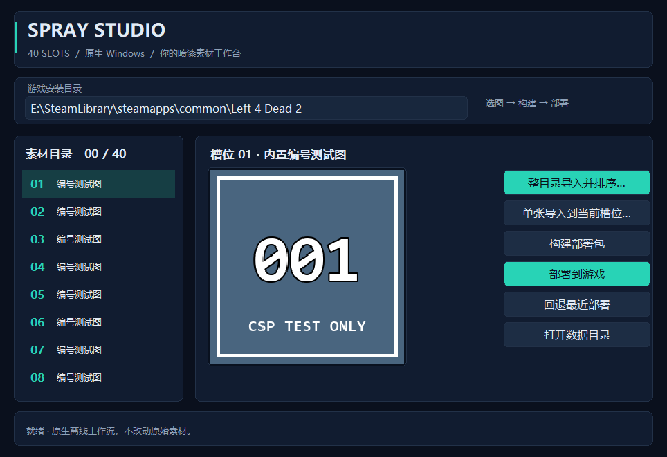

# v1.5.0 预发布：Spray Studio 1.2.0

本次更新独立 Go + Win32 喷漆工具的外观，并发布用户指定的内置图标。**C 仍为 1.3.2／DLL 1.3.1，游戏内喷漆选择器仍为 0.2.3；管理工具升级至 1.2.0。** 不覆盖旧 v1.4.0 Release。

## 新界面

- 深蓝底色、圆角卡片、青绿色主按钮；统一字体层级、素材编号、状态区及预览边框。
- 原生 Win32 自绘按钮与列表，保留键盘焦点、禁用和按下状态；没有引入 WebView、Electron 或 Python 运行依赖。
- 窗口、任务栏和 EXE 使用内置图标，包含 16／24／32／48／64／128／256 像素 7 种尺寸。原始大图未上传，仅派生图标／资源对象内置到程序并随源码发布。
- 原有目录导入、自然排序、40 槽位、构建校验、部署备份及回退逻辑保持不变。

下图为同一套 GDI 绘制函数生成的**离屏主题渲染预览，不是桌面截图**；素材为自制编号图，不读取用户图片。

## 下载

| 附件 | 用途 |
|---|---|
| `L4D2_ESC_All_Products_v1.5.0.zip` | 当前全部产物：game 下游戏文件，manager 下工具，另含文档、诊断素材及审查证据 |
| `CSP_Spray_Manager_v1.2.0.zip` | 推荐工具升级包：EXE、说明和渲染预览 |
| `CSP_Spray_Manager.exe` | 独立 EXE；复制时关闭旧工具，保留同目录 CSP_Spray_Data |
| `CSP_Selector_Complete_v1.5.0.zip` | 原有选择器 VPK／DLL 和必需的 80 个 update 素材；首次使用喷漆工具应先安装 |
| `C_session_release.zip` | 原有 C 1.3.2 成套文件，不需要重新设置 C 默认项 |
| `C_ESC_LED_Health_Speed_TUMTaRA.vpk` | 单独 C 资源，不含配套 DLL；优先下载成套包 |
| `CSP_Numbered_Test_Assets.vpk` | 诊断素材包，不要与完整选择器同时启用 |
| `numbered_contact_sheet.png` | 自制 40 张编号图总览 |
| `SHA256SUMS.txt` | 以上 8 个附件的 SHA-256 |

## 安装和使用

退出游戏并备份同路径文件。完整包中 **game 里面的内容**复制到含 left4dead2.exe 的游戏根目录；只装选择器则复制其 bin、left4dead2、update 三个目录。已有 x86 L4N 仍为前置条件，本发布不包含平台本体或 TUMTaRA 地图。

manager 中工具可放在可写目录运行。升级工具只替换 EXE，保留 `CSP_Spray_Data`；不要把它作为图片目录导入。导入图片后构建、退出游戏后部署，重启后在进入战役前使用“选项 → 多人游戏 → CSP TEST”选择喷漆。局内更换仍不保证即时刷新。

## 验证和边界

33 项 Go 测试连续两轮通过，含 ICO 多尺寸／透明度／确定性、界面布局边界、常用文字配色对比度、x64 DRAWITEMSTRUCT ABI 以及原有文件事务测试。原生窗口检查确认 40 槽位、6 个自绘按钮、列表和卡片实际绘制、后台任务回传及大小图标加载；独立 PE 检查逐项比较 7 个内置图标与 ICO 的 PNG 数据。

C 重新完成两轮静态／原生／恢复测试，产物未变化；选择器沿用已验证的固定版本。发布包重新核对 ZIP CRC／成员哈希，上传后逐附件核对 SHA-256 与大小。

当前桌面自动化连接不可用，因此完整人工点击、实际目录对话框和全部系统主题／DPI 组合仍待试用。渲染预览不冒充实机截图，对比度测试不等价于完整无障碍认证。原生 ABI 转换仍保留 Go vet 的 unsafeptr 例外，其余分析器通过。未知游戏版本仍按固定哈希／ABI 停用桥接，不自动适配。

本发布不含用户素材、工具数据、真实部署备份或原始图标大图，也不新增小地图、网络图高度自适应或局内喷漆即时刷新。
