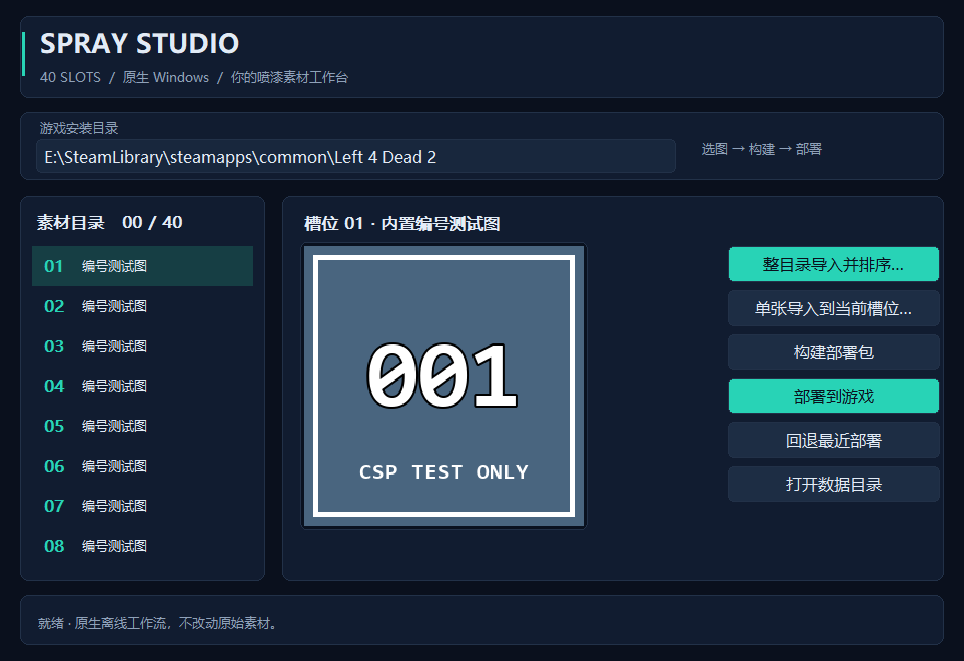

# CSP 喷漆导入工具

适用于本项目已经部署并实测可用的独立 **40 槽位喷漆选择器**，不是 C 自带功能。用户已确认：进入战役前选择有效；局内重新选择不会立即更新实际喷绘。本工具保留此行为，不修改引擎刷新机制。

## 当前版本：1.2.0 · Go + 原生 Win32 Spray Studio

当前入口已经替换成 **Go 编写前后端、直接调用 Win32/GDI 的 Windows x64 程序**。没有 Python 子进程，不需要安装 Python、Pillow、Go 或第三方 GUI 运行时。基础选择器的 167 个 VPK 成员内置在 EXE 中；游戏使用的 L4N/CSPSelector.dll 仍需预先安装，本程序不替换 DLL。

### 深色工作台与内置图标

1.2.0 改用深蓝卡片、青绿色主按钮、圆角边框、分层字体和自绘素材列表，保留原有功能／键盘焦点／禁用状态。Windows 支持时启用深色标题栏，未使用 WebView 或额外 GUI 框架。用户指定图片已转换为 16～256 像素的 7 尺寸 ICO，内置到 EXE、窗口和任务栏；不依赖旁边存在图片文件。

下图是同一主题绘制函数生成的**离屏渲染预览，不是桌面截图**；只使用自制编号图。



### 打开与操作

双击项目根目录的 **`启动喷漆导入工具.cmd`**，现在它启动的是：

```text
F:\Project\03_Game_Tools\14_L4D2_ESC\dist\spray_importer_go\CSP_Spray_Manager.exe
```

也可直接双击 EXE；将 EXE 放到有写入权限的目录即可使用。操作顺序：

1. 在顶部核对游戏目录，默认是本机 `E:\SteamLibrary\steamapps\common\Left 4 Dead 2`。其他安装位置可直接编辑，但当前只支持首条 MOD 搜索路径为 update 的相同布局。
2. 单张导入：左侧选择 01～40 槽位，点击“单张导入到当前槽位…”。批量导入：点击“整目录导入并排序…”，选择原始图片目录。中部显示透明棋盘底预览，左侧显示文件名。
3. 可继续导入其他槽位；随后点击“构建部署包”。未导入的槽位仍为内置编号图；已经导入的槽位继续保留，重新导入同一槽位不删除旧素材副本。
4. 退出游戏，点击“部署到游戏”，确认备份和更新。工具先检查游戏进程，再校验、备份、同步替换全部 81 个目标文件。
5. 重启游戏，在 CSP TEST 菜单中选择对应编号，再新开战役。局内更换不保证即时生效。
6. “回退最近部署”恢复本次部署前的完整 81 个文件；“打开数据目录”打开导入、构建与备份目录。

### 整目录导入与自动排序

- 包含子目录，筛选本版支持的图片扩展名；非图片文件略过，不跟随链接或重解析目录。工具不会自行扫描或读取某个预设喷漆目录，需要用户明确选择。
- 与已有导入图片合并，然后按文件名自然排序并连续分配 **01～40** 槽位。例如 `1.png、2.png、10.png`，不是 `1、10、2`。同名按相对路径和来源稳定排序；不承诺中文拼音排序。
- 本版本记录原始来源路径，重复导入同一路径会更新对应图片，不再新增一份。1.0.1 及更早的旧记录没有来源路径，升级后保留旧图片，不猜测或删除旧记录；首次再导入它们的原目录可能产生重复，需要自行核对。
- 单张导入仍尊重所选槽位，不触发全表排序；目录导入会重新排列已有图片，旧编号可能变化，确认窗口会提示。
- 源目录超过 40 张，或合并后超过 40 张，整批停止，不取前 40 张。支持扩展名的文件若损坏或编码不支持，也会停止整批提交，不悄悄跳过坏图。空目录不改变清单。
- 全部转换成功且磁盘清单仍一致后，才一次提交新的槽位表。批次目录 `CSP_Spray_Data/batches/<批次号>/` 保留转换素材、`before.json`、`after.json` 和成功摘要；失败可能留下转换中的私有素材，但不改变原始图片或已提交槽位表。
- 不允许把工具自己的数据目录作为图片来源递归导回。导入完成后仍须**重新构建，再退出游戏后部署**；导入本身不改游戏文件。

### 原生版支持的图片

- PNG、JPEG/JPG、静态 GIF、未压缩 24 位 BMP。
- 单帧二维 VTF 7.0～7.5：RGBA8888、BGRA8888、RGB888、BGR888、DXT1、DXT3、DXT5。不处理动画或环境贴图。
- **原生版当前不支持 TGA/WebP**，请先导出 PNG。JPEG 不自动按 EXIF 旋转，导入前请把方向实际保存到图像像素中。
- 输入最大 32 MiB，边长最大 8192、总像素最大 32M；等比双线性适配 256×256，保留透明并透明补边。输出为 262224 字节的普通 RGBA8888 VTF 7.2。

### 数据、备份与部署边界

EXE 同目录自动使用 `CSP_Spray_Data/`，内含 `slots.json`、`imports/`、`builds/`、`transactions/`、`latest.json`、`last-deploy.json`。不读取或迁移旧 Python 版的导入清单；要转移原生版配置，应连同该数据目录一起移动。当前游戏路径不会跨启动保存，非默认路径使用前须重新核对。同一数据目录有独占实例锁，避免多窗口互相覆盖记录。

实际部署对象仍为游戏 `left4dead2/addons/CSP_Numbered_Selector_TEST.vpk` 及 `update/materials/vgui/logos/csp_test/` 的 40 份 VTF、40 份 VMT。游戏中的这 81 个文件须已经存在，程序不是基础选择器的新装器。它不改 C、DLL、原生列表或 config.cfg，不清空其他喷漆缓存。

构建后又导入新图会触发“请重新构建”拦截；VPK 与 MOD 图片逐项校验一致。写入前保留所有原文件和哈希，单文件原子替换并读回，跨 81 个文件不是整体原子事务。中断后仍有 PREPARED 事务和备份。回退前校验所有目标与备份，发现外部修改则停止，不进行部分覆盖。

### 构建与验证

源码在 `native/spray_importer/`：`main_windows.go` 为窗口与文件／目录选择，`theme_windows.go` 为卡片／控件／字体颜色，`studio_preview_windows.go` 仅渲染自有离屏位图，`icon.go` 为多尺寸图标，其他模块仍负责图像、目录和文件事务。构建使用 Go 标准库，`CGO_ENABLED=0`，没有网络依赖下载。

本机没有 pwsh，使用现有 Windows PowerShell 执行正式构建脚本：

```powershell
powershell.exe -NoProfile -File native/spray_importer/build.ps1
```

仓库包含 `native/spray_importer/assets/selector.vpk` 的自制编号基线，构建时核对固定 SHA-256；若本机 dist 中有同名产物，也须匹配后才复制。Go 工具从干净克隆可使用仓库基线构建，不再强制要求先恢复 dist。正式 EXE 运行时不需要外部基线。

图标资源为 `assets/app.ico`、`app.rc` 和 `icon_windows_amd64.syso`，已提供预编译资源，普通构建不需要原始图片或资源编译器。更换图标可给构建脚本传入 `-IconSource "图片完整路径"`，此时需 PATH 中有 windres；原图不修改。MSVC cvtres 对象与本机 Go 链接器不兼容，已改用 windres。原始大图留在本地，不纳入仓库／Release。

当前 **33 项 Go 测试连续两轮通过，无跳过项**，包含原有 29 项测试，以及 ICO 多尺寸／透明度／确定性、主题布局边界、常用文字配色对比度、x64 DRAWITEMSTRUCT ABI。部署测试仅操作模拟游戏目录。实际 EXE 已通过 40 槽位、6 个自绘按钮、列表／卡片绘制、后台任务回传和大小图标加载检查；独立 PE 检查逐项核对 7 个图标 PNG 数据。真实目录选择对话框和完整人工点击仍待试用，对比度测试不是完整无障碍认证。

完整构建命令、原样输出、退出码、源码／EXE／基线哈希及受保护游戏文件哈希在 `reports/spray_importer_go/verification.json`，窗口检查结果在 `win32-smoke.json`。构建记录使用去除 PowerShell 包装对象后的 JSON，已修复旧记录步骤的循环引用卡顿。本次未向真实游戏部署新图片；人工文件选择与完整点击流程仍待试用，当前 UI 自动化连接不可用，不将自动冒烟检查描述为人工验收。

### 1.0.1 重复审查与修复

本轮先复现错误再增加回归，修复以下问题：

1. 外部修改 `slots.json` 后，旧窗口可能使用旧内存状态构建，却绑定新磁盘清单哈希；现在构建和导入会先检查一致性，提示重新打开工具，保留外部修改。
2. 未完成部署再次执行会覆盖最近恢复入口；现在 PREPARED／未知状态阻止新部署。开始恢复前先记录 ROLLBACK_PREPARED，恢复中断后仍能继续，不用新事务覆盖它。
3. GIF 原先先解码全部帧再拒绝动画；现在先扫描 GIF 块结构，确认单帧后再解码，并使用同一文件句柄限量读取输入。
4. 路径保护漏查基目录及上级重解析点；现在每次原子写入均检查完整路径。回归通过真实、仅位于测试目录内的 NTFS junction 验证，不依赖受限的符号链接权限。
5. 转换／构建／部署／回退原来阻塞窗口消息线程；现在后台执行并通过 Win32 消息完成提交，期间禁止重复操作，窗口继续处理重绘与移动。
6. 预览读取失败仍可能显示前一个槽位图片；现在清空旧预览并显示当前槽位失败状态。导入、构建、打开数据目录也不再被无关的游戏路径输入错误阻止。
7. 初始窗口改为按桌面工作区约束并居中；打开数据目录的错误现在有提示。窗口采用系统 DPI 缩放，建议至少提供 920×650 逻辑像素工作区；低于此尺寸及跨显示器 DPI 切换尚无完整适配保证。
8. 构建冒烟报告改为每次唯一文件，成功后才更新固定结果，避免误读上次的 PASS。

静态检查执行 `go vet -unsafeptr=false ./...`。保留的边界是 Win32 回调把 LPARAM 转为 MINMAXINFO／DRAWITEMSTRUCT 指针；普通 `go vet` 会对此必要的原生 ABI 转换报警，未宣称无条件全分析器零警告。其余分析器通过，实际窗口／尺寸／自绘消息覆盖相应边界。解析器另有 300 组确定性异常输入测试，不等价于无限范围模糊测试。

1.0.1 审查前 EXE 的原字节和 SHA-256 已保留于 `reports/spray_importer_go/before_review.exe` 与 `before_review_verification.json`；增加目录导入前版本另保存在 `before_directory_import.exe` 与对应记录。1.1.1 修复重复来源更新不确定性；当前 1.2.0 沿用该修复并增加深色界面和内置图标。游戏中的 C、选择器 VPK、CSPSelector.dll 和 GameUI 文件哈希未变。完整人工文件／目录选择和真实自定义喷漆验收仍需实际试用，有限审查不代表永久无缺陷保证。

---

## 旧版 Python 原型（历史说明，不是当前双击入口）

以下保留早期实现供追溯，其格式支持、数据目录、命令及测试记录只适用于 Python 原型，不替代上面的 Go 版说明。

### 旧版打开与使用

如需维护旧版，手动运行：

```powershell
python -B -X utf8 tools/spray_importer.py gui
```

1. 选择槽位 **1～40**，点击“选择图片并导入当前槽位”，查看预览。
2. 可以继续给其他槽位导入图片；同一槽位再次导入会更新当前记录，旧导入副本仍保留。
3. 点击“构建部署包”。未导入的槽位保留基线中的编号测试图；此前已导入的槽位继续使用已保存图片。
4. **退出游戏**，点击“部署到本机游戏”，确认部署。游戏运行时工具会停止部署，不会结束游戏进程。
5. 重启游戏，进入“选项 → 多人游戏 → CSP TEST”，选择对应编号、确认，然后新开战役。不要再用原生喷漆下拉框另选图片。

菜单目前仍以 **TEST 001～040** 标识固定槽位，图片预览会随导入同步更新；原文件名记录在本地清单中，不替换游戏菜单文字。窗口提供单张导入，不自动扫描整个目录，也不自动读取现有喷漆 MOD。

## 支持格式

- PNG、JPG/JPEG、BMP、TGA、静态 WebP。
- 单帧、二维、非环境贴图的 VTF 7.0～7.5：RGBA8888、BGRA8888、RGB888、BGR888，以及 DXT1/DXT3/DXT5。
- 其他 VTF 编码请先导出 PNG；动画贴图本版不导入。
- 输入最大 32 MiB、边长最大 8192。图片等比例缩放到 256×256，空白区域透明补齐，不拉伸、不裁切。
- 输出为普通 RGBA8888 VTF 7.2，单帧、单 mip，大小 262224 字节，低于本机引擎检查的 512 KiB 上限。不是 HDR 格式。

## 构建和部署内容

本地数据在 `dist/spray_importer/`：

| 路径 | 用途 |
|---|---|
| `imports/<生成号>/` | 转换后的 PNG 和 VTF；保留历史导入副本 |
| `slots.json` | 当前已导入的槽位、原图名称和素材哈希 |
| `builds/<生成号>/` | 完整选择器 VPK、80 份 MOD 路径素材及构建清单 |
| `latest.json` | 最近构建位置 |
| `transactions/<事务号>/before/` | 部署前全部 81 个文件的原字节备份 |
| `last_deploy.json` | 最近部署事务位置 |

每次部署同步处理：

```text
E:\SteamLibrary\steamapps\common\Left 4 Dead 2\left4dead2\addons\CSP_Numbered_Selector_TEST.vpk
E:\SteamLibrary\steamapps\common\Left 4 Dead 2\update\materials\vgui\logos\csp_test\test_001..040.vtf
E:\SteamLibrary\steamapps\common\Left 4 Dead 2\update\materials\vgui\logos\csp_test\test_001..040.vmt
```

VPK 内的贴图与 MOD 目录中的实际喷绘贴图保持一致。现有 VMT 已引用固定槽位路径，无需修改；菜单布局、按钮命令、DLL 和 C 不变。工具不会修改 gameinfo.txt、config.cfg、原生喷漆列表或固定名 spray.vtf。

**前置条件**：本机已经安装基础选择器 VPK、CSPSelector.dll、L4N，并完成 80 个 MOD 路径素材的部署。本工具只更新已存在的 81 个文件，不承担选择器的全新安装；游戏路径和首条 MOD 搜索路径按当前本机环境检查，其他安装路径需先适配。

## 保护与回退

- 写入前校验所有构建素材哈希及 VPK/MOD 一致性，备份全部目标文件，再逐个原子替换并读回验证。
- 导入记录在构建后发生变化时，部署会要求重新构建，避免把旧包误当新图部署。
- 部署不是跨 81 个文件的整体原子事务。中断后备份和 PREPARED 事务仍保留，可执行最近部署回退。
- 回退前检查全部备份与目标；发现外部改动则先停止，不覆盖外部改动。不会删除用户素材。
- “回退最近一次部署”只恢复该次部署前状态，不清空导入记录、不卸载基础选择器。

退出游戏后，也可运行：

```powershell
python -B -X utf8 tools/spray_importer.py rollback
```

命令行导入、构建和部署示例（将示例图片路径替换为实际文件）：

```powershell
python -B -X utf8 tools/spray_importer.py import --slot 17 --image "F:\Images\my_spray.png"
python -B -X utf8 tools/spray_importer.py build
python -B -X utf8 tools/spray_importer.py deploy
```

## 验证与当前边界

运行依赖为当前项目 Python 和 Pillow；双击入口还需要 Tkinter 与可用的 pythonw。当前提供脚本及图形窗口，不是独立 EXE。

执行 `python -B -X utf8 tools/review_spray_importer.py` 可重新运行两轮各 15 项测试、Tk 窗口布局冒烟检查，并生成一份自制示例图片的实际 VPK。测试涵盖常见图片／压缩 VTF、透明度、预览与实际素材一致、增量槽位、过期构建、部署／回退、外部修改与损坏素材拦截。

完整命令、输入、原样输出、退出码、源码哈希及示例产物位置记录在 `reports/spray_importer/verification.json`；示例 `patch.json` 记录基线／修改包哈希和变化成员。示例仅替换槽位 017 的贴图，其余 166 个 VPK 成员保持不变。测试使用自制图片和项目内模拟游戏目录，没有部署示例到真实游戏。真实自定义图片的最终观感及完整人工点击流程仍待实际使用验证。
